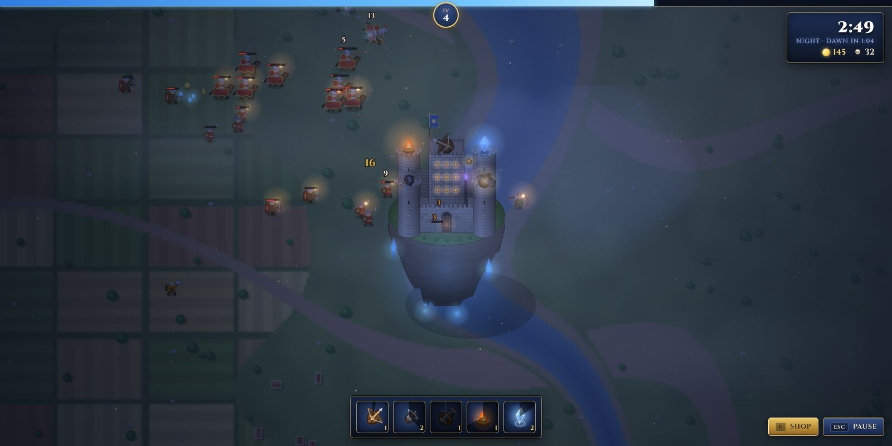

## What it is

SkyReign is a survival roguelike that runs in the browser. You pilot a castle on a floating island, fleeing a kingdom that wants it back. You start with a single ballista. Every enemy you beat drops gold and experience, and over twenty minutes the castle grows into a sky fortress bristling with crossbows, cannons, fire towers and lightning crystals. Survive until the King's Champion arrives at 20:00 and beat him to win the run.

[Play it in your browser](https://github.com/thatadamroberts/SkyReign#running). You can open `index.html` straight from disk.

## Why I built it

<!-- TODO: Write this in your own words. What got you started? A game you love in this genre, wanting to see how far plain JavaScript could go, or something else? -->

## No build step, no assets

The whole game is about 5,000 lines of plain HTML, CSS and JavaScript on a single canvas. It has no framework, no bundler and no image or audio files. That was a deliberate constraint, and it shaped everything else:

- **All the art is drawn in code.** The castle, the nine enemy types, the terrain, the clouds and the UI icons are all painted with canvas calls at startup, then cached as sprites. The farmland and rivers come from layered value noise.
- **All the sound is synthesised.** Effects such as ballista bolts and explosions come from WebAudio oscillators and noise. A separate ambience bus plays wind and birdsong, plus distant war drums by day. The game also has a hook so real samples can replace any sound later.
- **It runs from a double-click.** Every script is a classic `<script>` tag rather than a module, so `file://` works with no server.

## A castle that grows with you

The castle shows your progress. Each weapon slot becomes its own tower with the weapon on top. The walls and keep get taller as your max health rises, armour adds iron bands and rim spikes, and regeneration adds a chapel. The castle sprite is only redrawn when something changes, so this costs almost nothing per frame.

## The Director

A "Director" system controls the pacing, so the difficulty comes from a handful of curves instead of hand-built waves. Enemy health scales with `1 + 0.15m + 0.04m²`, where *m* is minutes survived, and spawn rate and damage follow similar curves. The army surges every minute, elites with gold crowns drop treasure chests, and a General attacks every five minutes. Generals fire volleys, charge, summon troops and become enraged at half health.

Up to 420 enemies can be on screen at once. A simple spatial hash grid keeps collision checks cheap enough for that.

## Night falls

Every four minutes night falls for about 90 seconds. I didn't redraw everything for night. Instead, night is a lighting pass on top of the normal renderer: a moonlit colour multiply, then glowing windows, crystals, torches and projectiles added on top, plus drifting fog and embers. Lightning flashes line up with thunder on the ambience bus, which switches to crickets, owls and a low drone after dark.

## Built with Claude Code

<!-- TODO: Confirm how much you want to say here. The commit history shows the game and the night update were built in Claude Code sessions. You might cover what you directed versus what it wrote, what surprised you, and what you'd do differently. Delete this section if you'd rather not mention it. -->

## What's next

<!-- TODO: Plans? For example: real audio samples through the audio hook, more weapons or enemies, a hosted playable version (GitHub Pages would work as it is), or balance changes. -->
